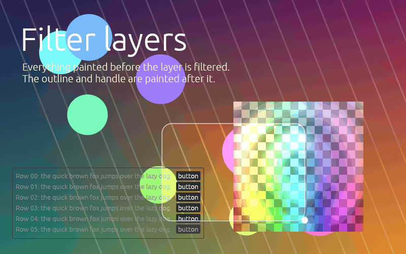
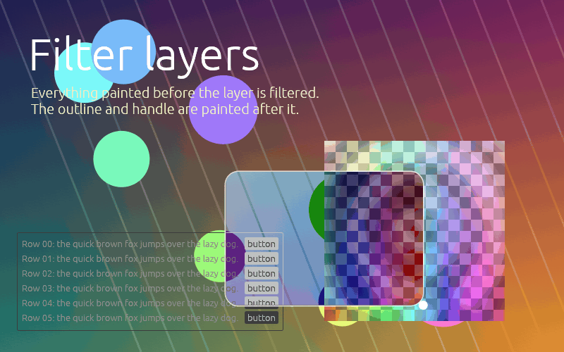
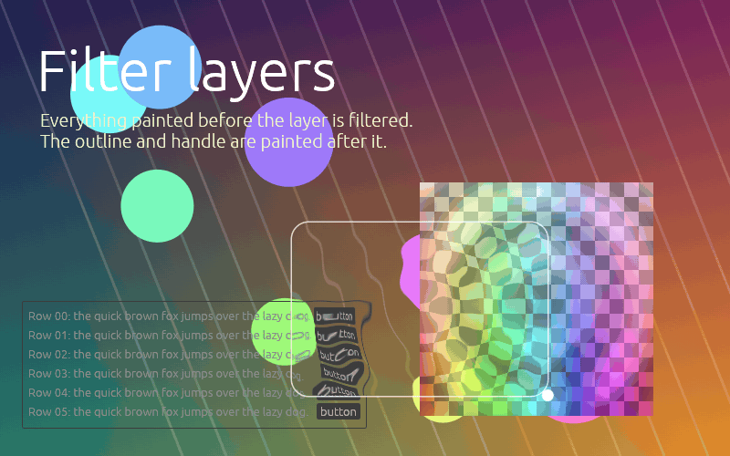

# egui_filter_layers

GPU **filter layers** for [egui](https://github.com/emilk/egui): a shape that takes everything
already painted beneath a rect and redraws that region through a chain of filter passes —
blur, colour adjustments, refraction, or your own WGSL shader.

- Presets: Gaussian blur, brightness/contrast, saturation, grayscale, invert, tint, sharpen,
  pixelate, ripple (animated), lens, vignette, frosted glass, click ripples (rings from
  clicks, driven by the `Impulses` helper; repaints only while a ring is alive), a fast large
  blur (`kawase_blur`, a dual-Kawase pyramid) and `bloom`; persistent-state presets `trails`
  and water (`wave_sim` + `wave_display`: a wave simulation with obstacles and click impulses).
- Persistent per-layer state: state passes (`Effect::new_state`) keep an RGBA16F field between
  frames for simulations and accumulation, on every backend and offline.
- Reduced-resolution passes (`Pass::with_scale(0.5)`): cheap large kernels, upsampled back.
- Custom effects: write one WGSL function; it is validated by [naga](https://github.com/gfx-rs/wgpu/tree/trunk/naga)
  when you build it, with errors pointing at your snippet.
- Named, typed effect parameters: declare `struct Params { ... }` in WGSL, set values by name
  from Rust (`pass.set("amount", 0.5)`), and reflect the members to build a UI.
- Hot reload of custom effects from `.wgsl` files (feature `hot-reload`, native): edits recompile
  off the GUI thread, the last good version keeps rendering while the file is broken, and named
  parameter values survive a reload (`HotEffect`, `rebind`).
- Input-driven effects: `Impulses` records clicks / taps that effects turn into transient
  animations (`presets::click_ripples`); the app repaints only while one is alive.
- Frame inputs in every effect: `fl.delta_time`, `fl.frame`, the pointer (`fl.pointer`) and the
  untouched backdrop (`original(uv)`) next to the pass input.
- User textures: attach up to three egui textures (noise, normal maps, LUTs) to a layer.
- Masks: the rect, a rounded rect, or any egui shape (paths, circles, meshes, text), anti-aliased.
- Offline processing of images and video with the same chains (features `image` / `video`).
- View-only: never touches egui textures or your data.
- One shader language on every backend (WGSL, translated to GLSL for OpenGL).

| Brightness / contrast | Invert | Ripple (animated) |
|---|---|---|
|  |  |  |

> [!WARNING]
> **wgpu: the content under a filter is rendered twice per frame.** egui-wgpu renders into a
> surface that cannot be read back mid-frame, so the wgpu backend re-renders everything painted
> beneath each filter layer (clipped to the layer's padded rect) into an offscreen texture, then
> filters it. Budget for that extra tessellation and fill. Paint callbacks beneath a filter
> (your own 3D views, other filter layers) cannot be re-rendered and are left out of its backdrop.

## Backends

| Renderer | How the backdrop is obtained | Status |
|---|---|---|
| `egui_glow`, OpenGL 3.3+ / OpenGL ES 3.0+ | copied from the framebuffer inside the paint callback (MSAA resolved) | supported (feature `glow`) |
| `egui_glow`, WebGL2 | same | supported (feature `glow`) |
| `egui_glow`, WebGL1 / OpenGL < 3.3 / OpenGL ES 2 | — | **unsupported**: `install_glow` returns `InstallError::Unsupported`, layers draw nothing |
| `egui-wgpu` (Vulkan, Metal, DX12, GL, WebGPU, WebGL2) | the content beneath is **rendered a second time** offscreen | supported (feature `wgpu`) |

Both features are on by default. Disable the one you do not use:

```toml
egui_filter_layers = { version = "0.2", default-features = false, features = ["glow"] }
```

## Compatibility

| egui_filter_layers | egui / eframe | wgpu (via egui-wgpu) | glow (via egui_glow) | MSRV |
|---|---|---|---|---|
| 0.2 | 0.36 | 30 (egui-wgpu 0.36) | 0.17 (egui_glow 0.36) | Rust 1.95 |
| 0.1 | 0.36 | 30 (egui-wgpu 0.36) | 0.17 (egui_glow 0.36) | Rust 1.95 |

These crates appear in the public API, so moving to a new egui / wgpu / glow line is a breaking
release of this crate. 0.2 changes the API in a few places (see the
[changelog](CHANGELOG.md#020---2026-09-29)): most 0.1 code compiles unchanged, but effects that
define functions named like the new prelude helpers (`original`, `tex`, `state`, ...) or a
`struct Params` of their own must rename them.

## Quick start (eframe + glow)

```rust
use eframe::egui;
use egui_filter_layers::{FilterLayer, presets};

struct App {
    ctx: egui::Context,
}

impl App {
    fn new(cc: &eframe::CreationContext<'_>) -> Self {
        if let Some(gl) = &cc.gl {
            // Logs and returns an error on unsupported contexts (e.g. WebGL1); never panics.
            if let Err(error) = egui_filter_layers::install_glow(&cc.egui_ctx, gl) {
                eprintln!("filters disabled: {error}");
            }
        }
        Self { ctx: cc.egui_ctx.clone() }
    }
}

impl eframe::App for App {
    fn ui(&mut self, ui: &mut egui::Ui, _frame: &mut eframe::Frame) {
        egui::CentralPanel::default_margins().show(ui, |ui| {
            ui.heading("Everything painted before the layer gets filtered");
            // ... your content ...
            let rect = egui::Rect::from_min_size(egui::pos2(60.0, 60.0), egui::vec2(300.0, 200.0));
            FilterLayer::new(rect, presets::gaussian_blur(8.0).then(presets::saturation(1.4)))
                .corner_radius(16)
                .paint(ui.painter());
        });
    }

    fn on_exit(&mut self, gl: Option<&eframe::glow::Context>) {
        // OpenGL objects need explicit teardown while the context is current.
        if let Some(gl) = gl {
            egui_filter_layers::destroy_glow(&self.ctx, gl);
        }
    }
}
```

## Quick start (eframe + wgpu)

```rust
fn new(cc: &eframe::CreationContext<'_>) -> Self {
    if let Some(render_state) = &cc.wgpu_render_state {
        // MUST describe egui's render pass: mirror your eframe::NativeOptions
        // (multisampling, depth_buffer, stencil_buffer, dithering). The default IS eframe's
        // default; e.g. `.with_multisampling(4)` if you set `multisampling: 4`.
        let options = egui_filter_layers::WgpuOptions::default();
        if let Err(error) = egui_filter_layers::install_wgpu(&cc.egui_ctx, render_state, options) {
            eprintln!("filters disabled: {error}");
        }
    }
    Self {}
}
```

No teardown is needed on wgpu: the GPU objects live in egui-wgpu's callback resources. If your
`App::clear_color` is not eframe's default, pass it with `WgpuOptions::with_clear_color` (it is the
backdrop wherever nothing opaque was painted). A custom integration that builds its own
`egui_wgpu::RendererOptions` can use `WgpuOptions::from(&renderer_options)`.

**`WgpuOptions` must match egui's render pass.** egui-wgpu does not expose its MSAA / depth
configuration, so the crate cannot check it: a mismatch is a wgpu validation error on egui's own
command encoder — a **panic** natively and on WebGL2 (wgpu's default error handler; eframe
installs none), a console error and a lost frame on browser WebGPU.

Show `egui_filter_layers::status(ctx)` somewhere during development: apart from a mismatched
`WgpuOptions`, a missing or failed backend never panics, it just leaves the backdrop unfiltered,
and `status` tells you why.

## Custom effects

An `Effect` is one WGSL function. `uv` is the position of the pixel being written inside the
captured region (`(0, 0)` top-left, y down); colours are premultiplied-alpha, gamma-space RGBA —
exactly what egui drew.

```rust
use egui_filter_layers::{Effect, FilterLayer, Pass};

let wave = Effect::new("wave", r#"
fn effect(uv: vec2<f32>) -> vec4<f32> {
    let amplitude = params(0u).x * fl.pixels_per_point;
    let offset = sin(uv.y * 40.0 + fl.time * 3.0) * amplitude;
    return src_px(vec2<f32>(offset, 0.0));
}
"#)?                       // EffectError carries naga's diagnostic and the line in your snippet
.with_sample_radius(6.0); // reads up to 6 points away: pad the capture

// Build the Effect once and keep it; per frame, only the Pass parameters change.
let pass = Pass::new(&wave).with_param(0, [6.0, 0.0, 0.0, 0.0])?;
FilterLayer::new(rect, pass).paint(ui.painter());
```

Prelude available to every effect:

| Name | Meaning |
|---|---|
| `src(uv)` | pass input, bilinear, clamped to the captured region |
| `src_px(offset)` | input at `offset` pixels of the input from the current pixel (physical pixels unless the previous pass is scaled) |
| `src_texel()`, `out_texel()` | one pixel of the pass's input / its own output, in `uv` units |
| `original(uv)` | the untouched captured backdrop (before any pass), readable in every pass |
| `p.<name>` | named parameter: member of the snippet's `struct Params` (below) |
| `params(i)` | `vec4<f32>` anonymous parameter slot `i` (`0..16`) of the pass (untyped; prefer named) |
| `tex(i, uv)` | user texture `i` (`0..3`, attached with `FilterLayer::texture`) at `uv` in its own 0..1 coordinates, through its own sampler (its egui `TextureOptions`) |
| `tex_size(i)`, `tex_load(i, px)` | its size in texels; its exact texel `px` (`vec2<i32>`, clamped, no filtering) |
| `state(uv)` | the layer's persistent state (below), bilinear; zero without a state pass |
| `state_load(px)`, `state_px(offset)` | an exact state texel (`vec2<i32>`, clamped) / the one under the current pixel, offset |
| `state_size()`, `state_texel()`, `fl.pass_index` | state size in texels; one state texel in `uv` units; this pass's index among the chain's passes of its kind (state substeps) |
| `fl.texel`, `fl.size_px` | one capture pixel in `uv` units; capture size in pixels (also in scaled passes) |
| `fl.pass_scale` | the pass's output resolution relative to the capture (`Pass::with_scale`, 1 = full) |
| `fl.rect_uv` | the layer rect inside the capture (`xy` min, `zw` size) |
| `fl.time`, `fl.pixels_per_point` | egui time in seconds; physical pixels per layer point (egui scale factor × layer zoom) |
| `fl.delta_time`, `fl.frame` | seconds since the previous frame (egui's `stable_dt`, clamped to `0..=0.1`); frame counter (`u32`, wrapping) |
| `fl.pointer` | pointer in `uv` (`xy`, outside `0..1` off the capture), `z` = 1 while the primary button is down, `w` = 1 when a pointer exists |
| `to_linear`, `to_gamma`, `premultiply`, `unpremultiply`, `luma` | colour helpers |

An effect whose code reads `fl.time` is detected as **animated** (from naga's IR, not a text
search): painting a layer with it requests an egui repaint every frame, so it keeps moving in an
otherwise idle app (copying the whole block, `let u = fl;`, also counts). Override with
`Effect::with_animated(false / true)`. Effects cannot declare their own bindings, entry points or
`override` constants. Reading `fl.delta_time`, `fl.frame` or `fl.pointer` does not make an effect
animated (pointer changes repaint anyway); offline they come from `OfflineOptions::with_delta_time`
/ `with_frame` / `with_pointer`, or from a video's frame clock.

Distances are in **layer points**: sample radii, corner radii and effect distances converted
with `fl.pixels_per_point` scale with the zoom of the layer the filter is painted in (an
`egui::Scene` or `Context::set_transform_layer`), just like the content around them — a 4-point
blur covers 8 pixels at zoom 2 — and the capture padding follows.

`EffectError::diagnostic()` returns naga's full report rendered against your snippet, so its line
numbers match `EffectError::location()`.

Chains run pass by pass (ping-pong): `presets::gaussian_blur(6.0).then(Pass::new(&wave))`.

A pass can run at reduced resolution: `Pass::new(&effect).with_scale(0.5)` renders
`ceil(capture * 0.5)` pixels per axis, and the next pass (or the final composite, bilinearly)
reads that smaller image. `uv`, `src()`, `original()`, `fl.texel` and `fl.size_px` keep their
capture meaning, so distance maths is unchanged; kernels that step in pixels use `src_px()` /
`src_texel()` (input pixels) or `out_texel()`. `presets::kawase_blur(radius)` and
`presets::bloom(threshold, intensity, radius)` are built from such passes.

```rust
let glow = presets::bloom(0.7, 1.2, 12.0);           // bright pass, scaled blur, combine
let big_blur = presets::kawase_blur(40.0);           // dual-Kawase pyramid, cheap at any radius
let half = Pass::new(&my_effect).with_scale(0.5);    // a custom pass at half resolution
```

### Input impulses

`Impulses` is a small collection kept in your app state: push an impulse where the user clicked,
hand it to `presets::click_ripples` (rings expanding from each click) or to your own effect
(`Impulses::apply` fills the named parameters `impulses: array<vec4<f32>, 16>` — each
`(uv.x, uv.y, age_seconds, strength)` — and `impulse_count: u32`).

```rust
use egui_filter_layers::{FilterLayer, Impulses, presets};

// App state: `let mut ripples = Impulses::new(1.5);` (each ripple lives 1.5 s)
let now = ui.input(|input| input.time);
let response = ui.interact(rect, ui.id().with("ripples"), egui::Sense::click());
if let Some(pos) = response.interact_pointer_pos().filter(|_| response.clicked()) {
    ripples.push_point(pos, rect, 1.0, now);
}
ripples.retire(now);
ripples.request_repaint_if_alive(ui.ctx(), now); // animates while a ring lives, idle afterwards
FilterLayer::new(rect, presets::click_ripples(&ripples, now, 6.0, 24.0, 120.0)).paint(ui.painter());
```

At most 16 impulses are kept (`with_capacity` lowers it); a full collection drops the oldest.

### Textures

A layer can attach up to three egui textures (`TEXTURE_SLOTS`) that its effects read — noise,
normal maps, lookup tables, images:

```rust
let noise = ctx.load_texture("noise", noise_image, egui::TextureOptions::LINEAR_REPEAT);
let displace = Effect::new("displace", r#"
fn effect(uv: vec2<f32>) -> vec4<f32> {
    let n = tex(0u, uv * 4.0).rg - vec2<f32>(0.5);
    return src(uv + n * 8.0 * fl.texel);
}
"#)?;
FilterLayer::new(rect, Pass::new(&displace).with_sample_radius(4.0)).texture(0, noise.id()).paint(ui.painter());
```

`tex(i, uv)` samples in the texture's own uv through the sampler of its egui `TextureOptions`
(filters, wrap mode); `tex_load(i, px)` reads one texel exactly. Values are premultiplied gamma
RGBA like `src()`. An effect that reads a slot with nothing attached is refused
(`FilterLayer::check_textures`; the layer draws nothing and the error is logged once), and a
texture id the renderer does not know (freed) skips its layer and is listed by
`failed_textures(ctx)`. Offline, attach an `OfflineTexture` with `OfflineOptions::with_texture`.

### Persistent state

A **state pass** (`Effect::new_state`) writes the layer's state — two RGBA16F textures that
survive from frame to frame — instead of the next image. Later passes (and the next frame) read
it with `state(uv)`, or exactly with `state_load(px)` / `state_px(offset)`; inside a state pass
`src()` is the display chain's input at that point. Consecutive state passes are substeps
(`fl.pass_index`). The layer needs an identity:

```rust
use egui_filter_layers::{FilterChain, FilterLayer, Impulses, presets};

// App state: impulses pushed where the user clicks (`impulses.push_point(pos, rect, 30.0, now)`).
let sim = presets::wave_sim(&impulses, now, &[menu_obstacle]);
let water = FilterChain::new().then(sim.clone()).then(sim).then(presets::wave_display(8.0, 0.6));
FilterLayer::new(rect, water).id(ui.id().with("water")).paint(ui.painter());
```

A stateful layer without `FilterLayer::id` is refused (`StateError::MissingId`, logged once).
The state spans the whole capture at `StateOptions::with_scale` resolution, lives in layer uv (a
moved or resized layer keeps it, stretched), starts at zero, is zeroed by `reset_state(ctx, id)`
and freed after 120 frames and 2 s unpainted; an id painted twice in one frame is stepped once.
RGBA16F must be renderable and filterable on the device, else stateful layers are refused and
listed by `failed_states(ctx)` (WebGL2 without `EXT_color_buffer_float`); `StateFormat::Rgba8Unorm`
is an explicit opt-in. It advances only on painted frames (request repaints while it moves).
Offline, the renderer carries the state from call to call (a video's frames); such chains are
never tiled.

### Masks

A layer filters its rect, a rounded rect (`corner_radius`), or any egui shape — paths, circles,
rects, meshes and text galleys, in the layer's points:

```rust
use egui_filter_layers::{FilterLayer, Mask, presets};

let lens = egui::Shape::circle_filled(rect.center(), 60.0, egui::Color32::WHITE);
FilterLayer::new(rect, presets::gaussian_blur(8.0)).mask(Mask::Shape(lens)).paint(ui.painter());
```

The shape's alpha is the coverage (paint it opaque; egui's feathered edge anti-aliases it, and a
translucent fill filters partially); outside it — and outside the rect — the backdrop is untouched,
on wgpu too (a lower filter layer shows through). The mask follows layer transforms; its feathered
edge scales with a `Scene` zoom (it is tessellated before the zoom is known). egui fills convex
paths only: build concave outlines from convex pieces **that overlap** (pieces meeting exactly edge
to edge leave a visible seam, because both feathered edges fade out along it) or from a mesh. Offline (`OfflineOptions::with_mask`)
text masks and textured meshes are refused (`OfflineError::Mask`: there is no font atlas offline).

### Named parameters

Declare `struct Params` in the snippet and read it as `p`; set values per pass by name. Types are
checked (`ParamError`, no panics), and `Effect::params()` lists every member (`ParamInfo`: name,
`ParamType`, offset, array length) so a UI can build its controls from the effect alone.

```rust
use egui_filter_layers::{Effect, Pass};

let tint = Effect::new("tint", r#"
struct Params {
    color: vec4<f32>,
    amount: f32,
}
fn effect(uv: vec2<f32>) -> vec4<f32> {
    return mix(src(uv), p.color, p.amount);
}
"#)?;
for info in tint.params() {
    println!("{}: {} at byte {}", info.name, info.ty, info.offset);
}
let pass = Pass::new(&tint).with("color", [1.0, 0.5, 0.0, 1.0])?.with("amount", 0.25)?;
```

Members may be `f32`, `i32`, `u32`, `vec2/3/4<f32>`, `mat4x4<f32>` or fixed-size arrays of
`vec3<f32>` / `vec4<f32>` / `mat4x4<f32>` (set with `Pass::set_slice`); the struct may be up to
16 KiB (the WebGL2 uniform block limit). Values start at zero. `params(i)` keeps working next
to named parameters.

### Hot reload

With the `hot-reload` feature (native), a `HotEffect` follows a `.wgsl` file: a background thread
polls its modification time and recompiles it off the GUI thread; `poll()` never blocks.

```rust
use egui_filter_layers::{HotEffect, HotOptions, HotReloadEvent, Pass, rebind};

// At startup:
let mut hot = HotEffect::watch_with("water", "shaders/water.wgsl", HotOptions::default().with_repaint(ctx))?;
// Every frame:
if hot.poll() == HotReloadEvent::Reloaded {
    if let Some(effect) = hot.current() {
        // Keeps named parameter values whose name and type still match.
        pass = Some(match &pass { Some(old) => rebind(old, effect).pass, None => Pass::new(effect) });
    }
}
if let Some(error) = hot.error() {
    ui.label(error.to_string()); // the last good effect keeps rendering meanwhile
}
```

## Semantics and limitations

- **"Beneath" means earlier in egui's paint order**: lower layers and shapes painted earlier into
  the same layer. Later shapes, higher `egui::Order` areas, popups and tooltips are drawn on top
  and are not filtered. Paint the filter layer right after the content it should affect.
- **Padding**: neighbourhood effects (blur, refraction) read beyond the rect. The capture is
  expanded by the chain's total sample radius and clamped to the screen; at the screen edge
  sampling clamps to the last pixel.
- **Precision**: the backdrop is 8-bit gamma-encoded; intermediates are RGBA16F where the GPU can
  render to it (wgpu adapters that report RGBA16F renderable + filterable, desktop GL 3.3, WebGL2
  with `EXT_color_buffer_float`), else RGBA8.
- **OpenGL resources** must be freed with `destroy_glow` from `App::on_exit`. Calling
  `install_glow` again with the same GL context frees the previous backend's objects first.
- **OpenGL framebuffer formats**: the backdrop is blitted out of the framebuffer, which requires a
  normalized fixed-point colour buffer; a multisampled one is resolved through a renderbuffer of
  the same format (RGBA8, RGB8, RGB565, RGBA4, RGB5_A1, RGB10_A2, SRGB8_ALPHA8). Layers painted
  into a float / integer / other framebuffer are skipped (logged once).
- **Failures are contained**: an effect the driver rejects (or whose draw raises a GL error) is
  disabled alone and listed by `failed_effects`; an attached texture the renderer does not know
  skips its layers and is listed by `failed_textures`; only failures of the crate's own GPU work disable
  the backend (`status`). Either way nothing panics and the backdrop stays unfiltered. With a failed
  backend, animated layers stop requesting repaints. The one exception is a `WgpuOptions` that
  does not match egui's render pass (see the wgpu quick start): it cannot be detected, and wgpu
  rejects egui's whole frame.
- The installed backend lives in the `egui::Context` itself, so resetting egui `Memory` does not
  uninstall it.
- **wgpu specifics**: the backdrop is re-rendered (see the warning above), so a filter over another
  filter sees the lower one's *unfiltered* backdrop, and paint callbacks beneath a filter are left
  out of its backdrop. Outside the mask (a rounded rect's corners, or anything outside a shape
  mask) the screen keeps what is already there, so a lower filter does show through the corners. The beneath content is
  collected by an egui plugin at the end of every pass (`Context::run_ui` / `end_pass`, which
  eframe uses). On an `*Srgb` surface the backdrop is re-rendered with egui's linear blending,
  except on GL / WebGL2 (no texture view formats): there semi-transparent edges under a filter
  blend in gamma and visibly differ from the unfiltered screen (about 25 steps measured for 50%
  white over dark grey; logged once); egui-wgpu
  prefers non-sRGB surfaces, so this is rare. egui-wgpu's `predictable_texture_filtering` is not
  mirrored by the re-render.
- **WebGL1 is not supported.**

## Offline: images and video

The same chains run outside the UI: `OfflineRenderer` filters an ordinary RGBA8 frame (an image,
a video frame) on wgpu and returns the pixels — what a filter layer covering that frame shows on
screen. Use it to export what an editor previews.

| Feature | Default | Adds |
|---|---|---|
| `glow` | yes | the `egui_glow` backend |
| `wgpu` | yes | the `egui-wgpu` backend |
| `image` | no | `OfflineRenderer` (implies `wgpu`) and PNG / JPEG adapters through the [`image`](https://crates.io/crates/image) crate (`default-features = false`) |
| `video` | no | `OfflineRenderer` (implies `wgpu`) plus video processing (`offline::video`): frame streams, source / sink traits, ffmpeg command-line adapters; no extra Rust dependencies |
| `hot-reload` | no | `HotEffect`: effects that follow a WGSL file (mtime polling on a std thread, no extra dependencies); native only, compiles to nothing on wasm32 |

Offline processing is wgpu-only; a glow app enables `image` / `video` just for export (its preview and
export then agree within rounding, not bit for bit). More image formats: enable them on your own
`image` dependency, e.g. `image = { version = "0.25", features = ["webp", "gif"] }`.

```rust
use egui_filter_layers::{AlphaMode, FrameRef, OfflineOptions, OfflineRenderer, presets};

// On a worker thread: processing blocks until the GPU is done.
let mut renderer = OfflineRenderer::from_render_state(&render_state)?; // or ::headless()?
let chain = presets::gaussian_blur(4.0).then(presets::vignette(0.6, 0.4, 0.5));
let options = OfflineOptions::default()
    .with_pixels_per_point(1.0) // image pixels per layer point
    .with_time(0.0);            // fl.time; the frame's timestamp for video
let frame = FrameRef::new(&rgba, width, height, AlphaMode::Straight);
let result = renderer.process(&frame, &chain, &options)?; // straight-alpha RGBA8

// With the `image` feature:
renderer.process_file("in.png".as_ref(), "out.jpg".as_ref(), &chain, &options)?;
```

User textures: `OfflineOptions::with_texture(slot, OfflineTexture::from_color_image(&image,
options)?)` — `from_color_image` holds exactly the bytes egui uploads for that image, so a
textured effect matches the UI bit for bit (tested, also tiled); `OfflineTexture::new` takes a
`FrameRef`. A texture is uploaded once and reused while the same `OfflineTexture` (or a clone)
stays attached, so a video passes one with every frame at no cost.

`process_into` reuses one output buffer for frame streams (decode a video with any library,
pass each frame with its presentation time); `process_async` is the non-blocking variant (on the
web, or anywhere the device is polled by someone else). `cargo run --example process_image
--features image -- in.png out.png` runs a complete example.

**Identical to the UI** (bit for bit) when all of these hold:

- the renderer runs on the UI's device (`OfflineRenderer::from_render_state`);
- the UI shows the frame 1:1 — one frame pixel per physical pixel, pixel-aligned — and the
  layer covers exactly the frame with its capture ending at the frame's edges (e.g. the frame
  fills the viewport); `with_pixels_per_point` is then egui's scale factor;
- dithering is off (`WgpuOptions::with_dithering(false)` and egui-wgpu's own) and the surface is not `*Srgb`;
- the frame is opaque, or `with_background` gives the colour it is drawn over in the UI.

Measured on the crate's GPU tests: 0 differing bytes for every preset and a custom effect at 1
and 2 pixels per point. The one exception is the 1-px antialiased edge of a rounded mask
(`corner_radius`): on wgpu the UI blends the filter over the screen by coverage there, so that
edge differs by up to one step (and on an sRGB surface, where the blend happens in linear like
egui's own antialiasing, by tens of steps: up to 70 measured on a high-contrast blur + invert).
Otherwise:

- dithering adds under one step to the UI's backdrop, which an effect amplifies by its gain
  (colour effects: 1-2 steps, a strong sharpen more); an sRGB surface differs by one step
  (outside a rounded mask's edge); a translucent frame over a background by one step;
- a frame shown at another zoom is filtered as a resampled image in the UI: a preview, not the
  export. Which `with_pixels_per_point` matches the editor's effect distances depends on how it
  zooms: an image *painted* `zoom` times larger (no layer transform) needs `ui_ppp / zoom`; a
  zoom by a layer transform (`egui::Scene`, the image painted 1:1 in layer points) scales the
  effects together with the image, so the match is the UI's `ppp` itself at any zoom;
- effects that sample *between* texel centres (refraction: ripple, lens, custom displacement,
  and `gaussian_blur` above `sigma * pixels_per_point = 32 / 3`, where its taps step over pixels)
  go through hardware bilinear filtering, whose sub-texel weights can differ rarely (a few pixels
  in 100 000, at most 2 steps) with the texture size — so when the UI's grow-only capture
  texture is larger than the layer, or when a frame is tiled;
- the pipeline is 8-bit (like the UI's capture): 16-bit images are converted first; colour
  profiles are ignored (sRGB assumed).

**Large frames** are processed in tiles overlapping by the chain's sample radius: by default
above 4096 pixels per side (`offline::DEFAULT_MAX_TILE_SIZE`, about 450 MiB of GPU memory per
run), or the cap set by `with_max_tile_size` (`None` = the device's texture limit), and always
within the device's texture and buffer limits. Results are identical to whole-frame processing
except for the rare sub-texel differences above — so a frame larger than 4096 pixels that the
UI shows untiled matches it bit for bit only with `with_max_tile_size(None)`. A device that runs
out of memory yields `OfflineError::OutOfMemory` (retry with smaller tiles), never a panic. Effects must not read further than their
declared sample radius — the `lens` preset reads anywhere in the layer, so give a tiled lens
`Pass::with_sample_radius`. Chains with a reduced-resolution pass (`with_scale`, `kawase_blur`,
`bloom`) or a state pass cannot be tiled exactly: a frame that would need tiles fails with
`OfflineError::NotTileable`; process it whole with `with_max_tile_size(None)`. A state pass's
state is carried by the renderer from one `process` call to the next (`OfflineOptions::with_state`,
`OfflineRenderer::reset_state`; a `VideoProcessor` continues it frame to frame and every
`process_video` stream starts from zero). At the frame border sampling clamps to the edge, exactly as the UI
clamps at the screen edge.

### Video

`video` gives four ways in, from the lowest level up:

1. **Your own decode loop**: `VideoProcessor::process_frame(&frame, time_seconds)` filters one
   frame; the device, pipelines, textures and readback buffers are reused across frames
   (`process_frame_into` fills your buffer, `process_frame_async` awaits). `time_seconds` becomes
   `fl.time`, so animated effects follow the video's timeline.
2. **Your own source and sink**: implement the small, object-safe `VideoSource` (`info`,
   `read_frame`) and `VideoSink` (`begin`, `write_frame`, `finish`, `abort`) traits — e.g. over
   [ffmpeg-next](https://crates.io/crates/ffmpeg-next) or GStreamer; their docs sketch both — and
   call `process_video(&mut processor, &mut source, &mut sink, progress)`. The progress callback
   sees every frame and cancels by returning `ControlFlow::Break`.
3. **The ffmpeg programs** (native): `FfmpegSource` / `FfmpegSink`, or in one call:

   ```rust
   use egui_filter_layers::offline::video::{VideoProcessor, ffmpeg::{AudioMode, FfmpegTranscode, VideoCodec}};

   let mut processor = VideoProcessor::new(OfflineRenderer::headless()?, chain, OfflineOptions::default());
   FfmpegTranscode::new("in.mp4", "out.mp4")
       .with_codec(VideoCodec::H264 { crf: 18 })   // or Vp9, Av1, ProRes4444, Ffv1, Gif, Custom
       .with_audio(AudioMode::Copy)                // the default; or Encode(args) / Drop
       .run(&mut processor, |progress| { println!("{:?}", progress.fraction()); ControlFlow::Continue(()) })?;
   ```

   `ffmpeg` and `ffprobe` **5.1 or newer** must be installed (on `PATH`, or located with
   `FfmpegTools`); they run as child processes and frames travel over pipes, so the crate links
   no ffmpeg code. **The ffmpeg build you install decides which codecs exist and their licence
   terms** (`libx264`, for one, is GPL). Codecs without alpha (H.264, AV1, GIF) reject
   translucent frames with an error unless `OfflineOptions::with_background` flattens them —
   transparency is never dropped silently (VP8/VP9 alpha in inputs is decoded with libvpx).
   WebM takes only Opus / Vorbis audio: use `AudioMode::Encode` there.

   **Colours match what the filters produced.** Inputs are converted to sRGB with their own
   YCbCr matrix and range tags (untagged video: BT.709 when HD, BT.601 when SD, as players
   assume; HDR and wide-gamut input is rejected with `VideoError::UnsupportedColor`). YCbCr
   outputs are converted explicitly with the BT.709 matrix to limited range and tagged BT.709,
   so players decode them back to the same colours; FFV1 is tagged sRGB. The first real video
   stream is used (cover art is skipped) and its sample aspect ratio is kept. The output is
   written to a temporary file beside it and renamed over it only on success, so it is never
   left half-written, and an output that is the input is refused (`VideoError::OutputIsInput`).
   The GIF preset keeps the whole clip in ffmpeg's memory until its palette is known — keep GIFs
   short.
4. **Image sequences** (with `image` too): `ImageSequenceSource::open(dir, "frame_%04d.png",
   frame_rate)` and `ImageSequenceSink::new(dir, "out_%04d.png")`.

**Timing**: the ffmpeg adapters produce **constant-frame-rate** video at the input's average frame
rate. A variable-frame-rate input is resampled to it (ffmpeg duplicates or drops frames, as
`-fps_mode cfr` does), and a video stream that starts after the file's audio is padded with its
first frame, which keeps passed-through audio in sync. Frame `i` gets `fl.time = i / frame_rate`
— its presentation time minus the first frame's. Rotation metadata is applied while decoding
(frames arrive upright; the output carries no rotation). `cargo run --example process_video
--features video -- in.mp4 out.mp4` runs a complete example.

## Demo

```sh
cargo run --example demo --features hot-reload -- --renderer glow
cargo run --example demo --features hot-reload -- --renderer glow --msaa 4
cargo run --example demo --features hot-reload -- --renderer wgpu
cargo run --example demo --features hot-reload -- --renderer wgpu --msaa 4 --stack lens --rect 500,150,300,200
cargo run --example demo --features hot-reload -- --scene stack --stack kawase_blur,bloom
```

Pick a scene in the side panel, or start on one with `--scene NAME`:

| `--scene` | Shows |
|---|---|
| `stack` (default) | the preset stack on a draggable, resizable rect: stack presets (incl. `kawase_blur`, `bloom`), tune named parameters, edit a custom WGSL effect live |
| `hot` | a `HotEffect` watching `examples/demo/scenes/hot.wgsl`, with an in-app editor |
| `ripples` | `click_ripples` driven by `Impulses` from clicks and drags |
| `water` | `wave_sim` + `wave_display` around a menu window that is a `WaveObstacle`, splashes, rain, pointer wake |
| `trails` | `presets::trails` behind moving content and a pointer brush |
| `bloom` | a custom bloom with a scaled bright pass vs `presets::bloom`; Gaussian vs Kawase blur with frame times |
| `textures` | noise displacement, normal-map refraction and a 3D colour LUT from user textures |
| `mask` | shape masks: a star from overlapping convex pieces, a circle, a text galley |

The "hot" scene edits `examples/demo/scenes/hot.wgsl` through `HotEffect` (hence the
`hot-reload` feature the demo requires): save from the in-app editor (Ctrl+S) or from any
editor, and the layer recompiles in the background; a compile error shows naga's diagnostic on
the layer while the last good version keeps running, and named parameter values survive the
reload (`rebind`).

`--stack name:v1:v2` overrides a preset's parameters, and `--record DIR` renders a seamless
4-second loop of the selected scene (no side panel, deterministic time, one PPM per frame) — the
GIFs above come from:

```sh
cargo run --example demo --features hot-reload -- --stack ripple:6:40:0.5 --record frames/
ffmpeg -framerate 25 -i frames/frame_%04d.ppm \
  -filter_complex "split[a][b];[a]palettegen[p];[b][p]paletteuse=dither=bayer:bayer_scale=4" -loop 0 waves.gif
```

**Wayland**: `--screenshot` and `--record` can hang on native Wayland: launched from a script,
the window draws its first two frames and then never redraws, so the capture never arrives. A
minimal eframe app that requests a repaint every frame stalls the same way, so this is winit /
eframe waiting for a frame callback the compositor does not send (typically for a window it does
not show), not the demo. Run under XWayland instead: `WAYLAND_DISPLAY= cargo run --example demo
--features hot-reload -- ... --screenshot out.ppm`.

## License

MIT — see [LICENSE](LICENSE).
